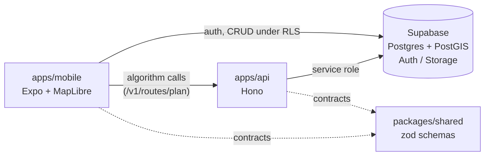

# Komyut Architecture

## Data flow rules

- **CRUD** (threads, votes, comments, profiles): mobile -> Supabase directly,
  protected by Row Level Security. No API hop.
- **Algorithms** (route planning, later karma computation and walkability
  scoring): mobile -> Hono API -> Supabase with the service role key.
- **Contracts:** every payload crossing a boundary is validated with a schema
  from `@komyut/shared` on both sides.

## Where future features plug in

| Feature | Seam |
| --- | --- |
| Real routing algorithm | Body of `POST /v1/routes/plan` (`apps/api/src/routes/plan.ts`) - graph over community route segments in PostGIS |
| Walkability scoring | Properties on route GeoJSON features; rendered by the interpolate expression in `KomyutMap.tsx` |
| Karma rules | New API routes + `profiles.karma`; triggers or API-side updates on votes |
| Voting / commenting UI | Direct Supabase writes from mobile (`votes`, `comments` tables already exist with RLS) |
| Image attachments | Supabase Storage bucket `thread-images` (public read, authenticated write) |

## Why this shape

One fork gives a teammate (and their AI assistant) the entire system. The
API stays thin on purpose: anything a database policy can enforce lives in
Supabase; anything algorithmic lives in TypeScript where it can be unit
tested (`vitest`) without a device.
