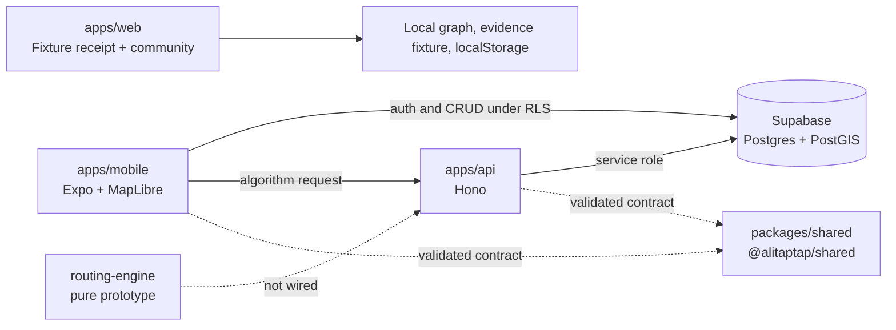

# Alitaptap architecture

## Current boundary

The web and mobile/API paths coexist intentionally but do not yet share one production adapter:

- `apps/web` proves the complete route-choice → evidence-receipt → community interaction on a deterministic Katipunan fixture.
- `apps/mobile` is the Expo client for route discovery, account, and community surfaces.
- `apps/api` owns algorithm-shaped and server-authorized work; direct CRUD stays behind Supabase Row Level Security.
- `packages/shared` validates payload crossing the mobile/API boundary.
- `routing-engine` is a pure prototype committed by a parallel lane and is not wired into a workspace or CI.

The integration seam is the receipt contract: route or place input → attributable evidence → deterministic score → visible receipt → explanation. Replacing a fixture adapter must not change what the receipt claims.

## Data flow rule

- **Web route receipt:** local graph and fixture evidence; community write persists in versioned localStorage.
- **Mobile CRUD:** mobile → Supabase under RLS.
- **Server algorithm:** mobile → Hono API → Supabase with the service-role key where needed.
- **Contract:** any mobile/API boundary payload is parsed by `@alitaptap/shared`.
- **Map:** MapLibre renders geometry; it does not own route selection or evidence truth.

## Production gate

Before promoting the web loop or routing prototype into the shared service, add licensed live routing/evidence adapters, field calibration, real Supabase/RLS integration tests, moderation and abuse review, and end-to-end route-receipt coverage.
