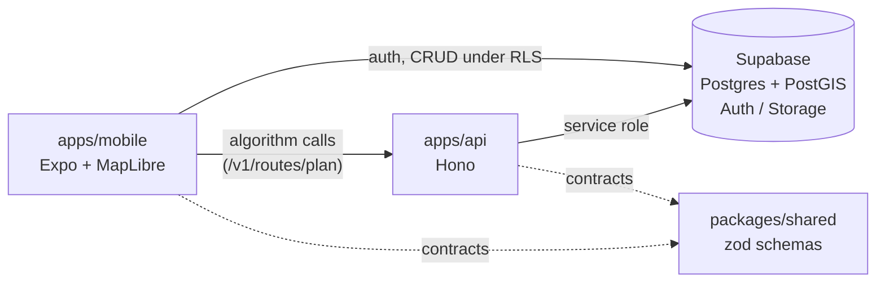

# Komyut Main Repo Scaffold Implementation Plan

> **For agentic workers:** REQUIRED SUB-SKILL: Use superpowers:subagent-driven-development (recommended) or superpowers:executing-plans to implement this plan task-by-task. Steps use checkbox (`- [ ]`) syntax for tracking.

**Goal:** Scaffold the Komyut monorepo (Expo mobile app + Hono API + shared zod package + Supabase migrations + docs + CI) and push it to `github.com/codex-zerocodeX/buildathon`.

**Architecture:** npm-workspaces monorepo. The mobile app talks to Supabase directly for auth/data/storage and to a thin Hono API for algorithm-shaped logic (route planning). `@komyut/shared` holds zod schemas as the single source of truth for API contracts. Supabase schema ships as SQL migrations in git.

**Tech Stack:** TypeScript (strict), Expo (latest SDK) + Expo Router, MapLibre React Native + OSM tiles, Hono + @hono/node-server, Supabase (Postgres + PostGIS, Auth, Storage), zod v4, TanStack Query v5, Zustand, Vitest, GitHub Actions.

**Spec:** `docs/superpowers/specs/2026-07-18-komyut-main-repo-design.md`

## Global Constraints

- Node `22` (pinned in `.nvmrc`); npm workspaces only — no yarn/pnpm.
- TypeScript `strict: true` in every package; all packages named `@komyut/*`.
- All API responses are JSON `{data}` on success or `{error}` (+ optional `issues`) on failure. Server errors never leak internals.
- Server state = TanStack Query; UI state = Zustand; validation = zod schemas from `@komyut/shared`.
- Secrets never committed — only `.env.example` files with placeholder values.
- Conventional commit messages (`feat:`, `docs:`, `chore:`, `ci:`); commit at the end of every task.
- Working directory for all commands is the repo root `/Users/a1234/Business/SakayDupe` unless a step says otherwise.
- Dependency versions: install with the ranges shown; do not pin exact patch versions.

---

### Task 1: Monorepo root + git init

**Files:**
- Create: `package.json`, `.nvmrc`, `.gitignore`
- Already on disk (commit them): `docs/superpowers/specs/2026-07-18-komyut-main-repo-design.md`, `docs/superpowers/plans/2026-07-18-komyut-main-repo-scaffold.md`

**Interfaces:**
- Produces: workspace globs `apps/*`, `packages/*`; root scripts `typecheck`/`lint`/`test` (fan out via `--workspaces --if-present`) that every later task's verification relies on.

- [ ] **Step 1: Create root package.json**

```json
{
  "name": "komyut",
  "version": "0.1.0",
  "private": true,
  "workspaces": ["apps/*", "packages/*"],
  "scripts": {
    "typecheck": "npm run typecheck --workspaces --if-present",
    "lint": "npm run lint --workspaces --if-present",
    "test": "npm run test --workspaces --if-present",
    "dev:api": "npm run dev --workspace apps/api",
    "dev:mobile": "npm run start --workspace apps/mobile"
  },
  "engines": { "node": ">=22" }
}
```

- [ ] **Step 2: Create .nvmrc**

```
22
```

- [ ] **Step 3: Create .gitignore**

```
node_modules/
.env
.env.*
!.env.example
.expo/
dist/
dist-check/
*.log
.DS_Store
```

- [ ] **Step 4: git init and verify status**

Run: `git init -b main && git status --short`
Expected: untracked entries for `package.json`, `.nvmrc`, `.gitignore`, `docs/`

- [ ] **Step 5: Commit**

```bash
git add -A
git commit -m "chore: init komyut monorepo root with workspaces, specs, and plan"
```

---

### Task 2: `@komyut/shared` — zod schemas (TDD)

**Files:**
- Create: `tsconfig.base.json` (repo root), `packages/shared/package.json`, `packages/shared/tsconfig.json`, `packages/shared/src/schemas.ts`, `packages/shared/src/index.ts`
- Test: `packages/shared/src/schemas.test.ts`

**Interfaces:**
- Produces (imported by API and mobile as `@komyut/shared`):
  - Schemas: `ProfileSchema`, `ThreadSchema`, `ThreadCategorySchema`, `VoteSchema`, `CommentSchema`, `LatLngSchema`, `RoutePlanRequestSchema`, `RoutePlanResponseSchema`
  - Types: `Profile`, `Thread`, `ThreadCategory`, `Vote`, `Comment`, `LatLng`, `RoutePlanRequest`, `RoutePlanResponse` (all `z.infer` of the above)

- [ ] **Step 1: Create root tsconfig.base.json**

```json
{
  "compilerOptions": {
    "target": "ES2022",
    "module": "ESNext",
    "moduleResolution": "bundler",
    "strict": true,
    "skipLibCheck": true,
    "noEmit": true,
    "forceConsistentCasingInFileNames": true
  }
}
```

- [ ] **Step 2: Create packages/shared/package.json and tsconfig.json**

`packages/shared/package.json`:

```json
{
  "name": "@komyut/shared",
  "version": "0.1.0",
  "private": true,
  "type": "module",
  "main": "src/index.ts",
  "exports": { ".": "./src/index.ts" },
  "scripts": {
    "test": "vitest run",
    "typecheck": "tsc --noEmit",
    "lint": "eslint src"
  },
  "dependencies": { "zod": "^4.0.0" },
  "devDependencies": { "typescript": "^5.6.0", "vitest": "^3.0.0" }
}
```

`packages/shared/tsconfig.json`:

```json
{
  "extends": "../../tsconfig.base.json",
  "include": ["src"]
}
```

Then run: `npm install`
Expected: lockfile `package-lock.json` created at root, `node_modules` populated, no errors.

- [ ] **Step 3: Write the failing test**

`packages/shared/src/schemas.test.ts`:

```ts
import { describe, expect, it } from "vitest";
import {
  RoutePlanRequestSchema,
  ThreadSchema,
  VoteSchema,
} from "./schemas";

const validThread = {
  id: "9b1deb4d-3b7d-4bad-9bdd-2b0d7b3dcb6d",
  author_id: "5a2f8f3e-3b2a-4c58-9d7a-1e2f3a4b5c6d",
  title: "EDSA Carousel is fastest at rush hour",
  body: "Take the busway from Monumento. Skip the regular city bus.",
  category: "route",
  image_url: null,
  created_at: "2026-07-18T00:00:00+00:00",
};

describe("ThreadSchema", () => {
  it("accepts a valid thread", () => {
    expect(ThreadSchema.parse(validThread)).toEqual(validThread);
  });

  it("rejects an unknown category", () => {
    const result = ThreadSchema.safeParse({ ...validThread, category: "gossip" });
    expect(result.success).toBe(false);
  });
});

describe("VoteSchema", () => {
  it("rejects a zero vote value", () => {
    const result = VoteSchema.safeParse({
      thread_id: validThread.id,
      user_id: validThread.author_id,
      value: 0,
      created_at: validThread.created_at,
    });
    expect(result.success).toBe(false);
  });
});

describe("RoutePlanRequestSchema", () => {
  it("rejects out-of-range latitude", () => {
    const result = RoutePlanRequestSchema.safeParse({
      origin: { lat: 999, lng: 121.0 },
      destination: { lat: 14.6, lng: 121.0 },
    });
    expect(result.success).toBe(false);
  });
});
```

- [ ] **Step 4: Run test to verify it fails**

Run: `npm test -w packages/shared`
Expected: FAIL — cannot resolve `./schemas`

- [ ] **Step 5: Implement the schemas**

`packages/shared/src/schemas.ts`:

```ts
import { z } from "zod";

export const ThreadCategorySchema = z.enum([
  "route",
  "terminal",
  "hazard",
  "walkability",
  "general",
]);

export const ProfileSchema = z.object({
  id: z.uuid(),
  username: z.string().min(3).max(30),
  karma: z.number().int(),
  created_at: z.string(),
});

export const ThreadSchema = z.object({
  id: z.uuid(),
  author_id: z.uuid(),
  title: z.string().min(1).max(200),
  body: z.string().max(5000),
  category: ThreadCategorySchema,
  image_url: z.url().nullable(),
  created_at: z.string(),
});

export const VoteSchema = z.object({
  thread_id: z.uuid(),
  user_id: z.uuid(),
  value: z.union([z.literal(1), z.literal(-1)]),
  created_at: z.string(),
});

export const CommentSchema = z.object({
  id: z.uuid(),
  thread_id: z.uuid(),
  author_id: z.uuid(),
  body: z.string().min(1).max(2000),
  image_url: z.url().nullable(),
  created_at: z.string(),
});

export const LatLngSchema = z.object({
  lat: z.number().min(-90).max(90),
  lng: z.number().min(-180).max(180),
});

export const RoutePlanRequestSchema = z.object({
  origin: LatLngSchema,
  destination: LatLngSchema,
});

export const RoutePlanResponseSchema = z.object({
  route: z.object({
    type: z.literal("Feature"),
    geometry: z.object({
      type: z.literal("LineString"),
      coordinates: z.array(z.tuple([z.number(), z.number()])),
    }),
    properties: z.object({
      walkability_score: z.number().min(0).max(100),
      summary: z.string(),
    }),
  }),
});

export type ThreadCategory = z.infer<typeof ThreadCategorySchema>;
export type Profile = z.infer<typeof ProfileSchema>;
export type Thread = z.infer<typeof ThreadSchema>;
export type Vote = z.infer<typeof VoteSchema>;
export type Comment = z.infer<typeof CommentSchema>;
export type LatLng = z.infer<typeof LatLngSchema>;
export type RoutePlanRequest = z.infer<typeof RoutePlanRequestSchema>;
export type RoutePlanResponse = z.infer<typeof RoutePlanResponseSchema>;
```

`packages/shared/src/index.ts`:

```ts
export * from "./schemas";
```

Note: `z.uuid()` / `z.url()` are zod v4 APIs. If npm resolved zod 3.x, fix the version range — do not rewrite to `z.string().uuid()`.

- [ ] **Step 6: Run tests and typecheck to verify they pass**

Run: `npm test -w packages/shared && npm run typecheck -w packages/shared`
Expected: 4 tests PASS; tsc exits 0.

- [ ] **Step 7: Commit**

```bash
git add tsconfig.base.json packages/shared package-lock.json
git commit -m "feat: add @komyut/shared zod schemas for threads, votes, comments, route plans"
```

---

### Task 3: API scaffold + GET /health (TDD)

**Files:**
- Create: `apps/api/package.json`, `apps/api/tsconfig.json`, `apps/api/.env.example`, `apps/api/src/app.ts`, `apps/api/src/routes/health.ts`, `apps/api/src/index.ts`
- Test: `apps/api/src/routes/__tests__/helpers.ts`, `apps/api/src/routes/__tests__/health.test.ts`

**Interfaces:**
- Consumes: `@komyut/shared` (nothing yet in this task; dependency declared here).
- Produces: `createApp(deps: AppDeps): Hono` from `apps/api/src/app.ts` where `AppDeps = { supabase: SupabaseClient }` — Tasks 4–5 mount routes inside it and tests construct the app with a fake client. Test helper `fakeSupabase(result: { data: unknown; error: unknown }): SupabaseClient`.

- [ ] **Step 1: Create package files**

`apps/api/package.json`:

```json
{
  "name": "@komyut/api",
  "version": "0.1.0",
  "private": true,
  "type": "module",
  "scripts": {
    "dev": "tsx watch --env-file=.env src/index.ts",
    "start": "tsx --env-file=.env src/index.ts",
    "test": "vitest run",
    "typecheck": "tsc --noEmit",
    "lint": "eslint src"
  },
  "dependencies": {
    "@hono/node-server": "^1.13.0",
    "@komyut/shared": "*",
    "@supabase/supabase-js": "^2.47.0",
    "hono": "^4.6.0",
    "zod": "^4.0.0"
  },
  "devDependencies": {
    "@types/node": "^22.0.0",
    "tsx": "^4.19.0",
    "typescript": "^5.6.0",
    "vitest": "^3.0.0"
  }
}
```

`apps/api/tsconfig.json`:

```json
{
  "extends": "../../tsconfig.base.json",
  "compilerOptions": { "types": ["node"] },
  "include": ["src"]
}
```

`apps/api/.env.example`:

```
SUPABASE_URL=https://your-project-ref.supabase.co
SUPABASE_SERVICE_ROLE_KEY=your-service-role-key-here
PORT=8787
```

Then run: `npm install`
Expected: exits 0.

- [ ] **Step 2: Write the failing test**

`apps/api/src/routes/__tests__/helpers.ts`:

```ts
import type { SupabaseClient } from "@supabase/supabase-js";

/** Fake for the exact query chain the API uses: from().select().order().limit() */
export function fakeSupabase(result: { data: unknown; error: unknown }): SupabaseClient {
  return {
    from: () => ({
      select: () => ({
        order: () => ({
          limit: async () => result,
        }),
      }),
    }),
  } as unknown as SupabaseClient;
}
```

`apps/api/src/routes/__tests__/health.test.ts`:

```ts
import { describe, expect, it } from "vitest";
import { createApp } from "../../app";
import { fakeSupabase } from "./helpers";

describe("GET /health", () => {
  it("reports ok", async () => {
    const app = createApp({ supabase: fakeSupabase({ data: [], error: null }) });
    const res = await app.request("/health");
    expect(res.status).toBe(200);
    expect(await res.json()).toEqual({ data: { status: "ok" } });
  });
});
```

- [ ] **Step 3: Run test to verify it fails**

Run: `npm test -w apps/api`
Expected: FAIL — cannot resolve `../../app`

- [ ] **Step 4: Implement app + health route + entry**

`apps/api/src/routes/health.ts`:

```ts
import { Hono } from "hono";

export function healthRoute() {
  const route = new Hono();
  route.get("/", (c) => c.json({ data: { status: "ok" } }));
  return route;
}
```

`apps/api/src/app.ts`:

```ts
import { Hono } from "hono";
import type { SupabaseClient } from "@supabase/supabase-js";
import { healthRoute } from "./routes/health";

export type AppDeps = { supabase: SupabaseClient };

export function createApp(deps: AppDeps) {
  void deps; // used by Tasks 4-5 when data routes mount
  const app = new Hono();
  app.route("/health", healthRoute());
  return app;
}
```

`apps/api/src/index.ts`:

```ts
import { serve } from "@hono/node-server";
import { createClient } from "@supabase/supabase-js";
import { createApp } from "./app";

const url = process.env.SUPABASE_URL;
const key = process.env.SUPABASE_SERVICE_ROLE_KEY;
if (!url || !key) {
  console.error("Missing SUPABASE_URL or SUPABASE_SERVICE_ROLE_KEY. Copy .env.example to .env first.");
  process.exit(1);
}

const app = createApp({ supabase: createClient(url, key) });
const port = Number(process.env.PORT ?? 8787);

serve({ fetch: app.fetch, port }, () => {
  console.log(`Komyut API listening on http://localhost:${port}`);
});
```

- [ ] **Step 5: Run test to verify it passes**

Run: `npm test -w apps/api && npm run typecheck -w apps/api`
Expected: 1 test PASS; tsc exits 0.

- [ ] **Step 6: Boot smoke test with placeholder env**

```bash
cp apps/api/.env.example apps/api/.env
npm run start -w apps/api & API_PID=$!; sleep 3; curl -s http://localhost:8787/health; kill $API_PID
```

Expected: curl prints `{"data":{"status":"ok"}}` (placeholder Supabase creds are fine — no query runs on /health).

- [ ] **Step 7: Commit**

```bash
git add apps/api package-lock.json
git commit -m "feat: add hono api scaffold with /health endpoint"
```

---

### Task 4: GET /v1/threads (TDD)

**Files:**
- Create: `apps/api/src/routes/threads.ts`
- Modify: `apps/api/src/app.ts`
- Test: `apps/api/src/routes/__tests__/threads.test.ts`

**Interfaces:**
- Consumes: `createApp`/`AppDeps` (Task 3), `fakeSupabase` (Task 3), `ThreadSchema` (Task 2).
- Produces: `GET /v1/threads` → `{data: Thread[]}` (newest first, max 50) or 500 `{error: "Failed to load threads"}`. Mobile Task 8's `useThreads` hook calls this.

- [ ] **Step 1: Write the failing test**

`apps/api/src/routes/__tests__/threads.test.ts`:

```ts
import { describe, expect, it } from "vitest";
import { createApp } from "../../app";
import { fakeSupabase } from "./helpers";

const sampleThread = {
  id: "9b1deb4d-3b7d-4bad-9bdd-2b0d7b3dcb6d",
  author_id: "5a2f8f3e-3b2a-4c58-9d7a-1e2f3a4b5c6d",
  title: "EDSA Carousel is fastest at rush hour",
  body: "Take the busway from Monumento. Skip the regular city bus.",
  category: "route",
  image_url: null,
  created_at: "2026-07-18T00:00:00+00:00",
};

describe("GET /v1/threads", () => {
  it("returns threads from supabase", async () => {
    const app = createApp({ supabase: fakeSupabase({ data: [sampleThread], error: null }) });
    const res = await app.request("/v1/threads");
    expect(res.status).toBe(200);
    expect(await res.json()).toEqual({ data: [sampleThread] });
  });

  it("returns a generic 500 when supabase fails", async () => {
    const app = createApp({ supabase: fakeSupabase({ data: null, error: { message: "boom" } }) });
    const res = await app.request("/v1/threads");
    expect(res.status).toBe(500);
    expect(await res.json()).toEqual({ error: "Failed to load threads" });
  });
});
```

- [ ] **Step 2: Run test to verify it fails**

Run: `npm test -w apps/api`
Expected: threads tests FAIL with 404 (route not mounted); health still passes.

- [ ] **Step 3: Implement the route**

`apps/api/src/routes/threads.ts`:

```ts
import { Hono } from "hono";
import { z } from "zod";
import { ThreadSchema } from "@komyut/shared";
import type { AppDeps } from "../app";

export function threadsRoute({ supabase }: AppDeps) {
  const route = new Hono();

  route.get("/", async (c) => {
    const { data, error } = await supabase
      .from("threads")
      .select("id, author_id, title, body, category, image_url, created_at")
      .order("created_at", { ascending: false })
      .limit(50);

    if (error) {
      console.error("threads query failed:", error.message);
      return c.json({ error: "Failed to load threads" }, 500);
    }
    return c.json({ data: z.array(ThreadSchema).parse(data) });
  });

  return route;
}
```

Modify `apps/api/src/app.ts` — replace the whole file with:

```ts
import { Hono } from "hono";
import type { SupabaseClient } from "@supabase/supabase-js";
import { healthRoute } from "./routes/health";
import { threadsRoute } from "./routes/threads";

export type AppDeps = { supabase: SupabaseClient };

export function createApp(deps: AppDeps) {
  const app = new Hono();
  app.route("/health", healthRoute());
  app.route("/v1/threads", threadsRoute(deps));
  return app;
}
```

- [ ] **Step 4: Run tests to verify they pass**

Run: `npm test -w apps/api && npm run typecheck -w apps/api`
Expected: 3 tests PASS; tsc exits 0.

- [ ] **Step 5: Commit**

```bash
git add apps/api/src
git commit -m "feat: add GET /v1/threads backed by supabase"
```

---

### Task 5: POST /v1/routes/plan mock (TDD)

**Files:**
- Create: `apps/api/src/routes/plan.ts`
- Modify: `apps/api/src/app.ts`
- Test: `apps/api/src/routes/__tests__/plan.test.ts`

**Interfaces:**
- Consumes: `createApp`/`AppDeps`, `fakeSupabase`, `RoutePlanRequestSchema`/`RoutePlanResponseSchema` (Task 2).
- Produces: `POST /v1/routes/plan` accepting `{origin: {lat, lng}, destination: {lat, lng}}` → `{data: RoutePlanResponse}` (mock straight line, walkability_score 50) or 400 `{error: "Invalid request", issues: [...]}`. This is the seam for the real routing algorithm.

- [ ] **Step 1: Write the failing test**

`apps/api/src/routes/__tests__/plan.test.ts`:

```ts
import { describe, expect, it } from "vitest";
import { createApp } from "../../app";
import { fakeSupabase } from "./helpers";

function makeApp() {
  return createApp({ supabase: fakeSupabase({ data: [], error: null }) });
}

describe("POST /v1/routes/plan", () => {
  it("returns a mock GeoJSON route from origin to destination", async () => {
    const res = await makeApp().request("/v1/routes/plan", {
      method: "POST",
      headers: { "content-type": "application/json" },
      body: JSON.stringify({
        origin: { lat: 14.5547, lng: 121.0244 },
        destination: { lat: 14.6091, lng: 121.0223 },
      }),
    });
    expect(res.status).toBe(200);
    const json = await res.json();
    expect(json.data.route.geometry.type).toBe("LineString");
    expect(json.data.route.geometry.coordinates[0]).toEqual([121.0244, 14.5547]);
    expect(json.data.route.geometry.coordinates[1]).toEqual([121.0223, 14.6091]);
    expect(json.data.route.properties.walkability_score).toBe(50);
  });

  it("rejects out-of-range coordinates with 400", async () => {
    const res = await makeApp().request("/v1/routes/plan", {
      method: "POST",
      headers: { "content-type": "application/json" },
      body: JSON.stringify({
        origin: { lat: 999, lng: 121.0244 },
        destination: { lat: 14.6091, lng: 121.0223 },
      }),
    });
    expect(res.status).toBe(400);
    const json = await res.json();
    expect(json.error).toBe("Invalid request");
    expect(Array.isArray(json.issues)).toBe(true);
  });

  it("rejects a non-JSON body with 400", async () => {
    const res = await makeApp().request("/v1/routes/plan", { method: "POST", body: "not json" });
    expect(res.status).toBe(400);
  });
});
```

- [ ] **Step 2: Run test to verify it fails**

Run: `npm test -w apps/api`
Expected: plan tests FAIL with 404; other tests pass.

- [ ] **Step 3: Implement the route**

`apps/api/src/routes/plan.ts`:

```ts
import { Hono } from "hono";
import { RoutePlanRequestSchema, RoutePlanResponseSchema } from "@komyut/shared";

export function routePlanRoute() {
  const route = new Hono();

  route.post("/plan", async (c) => {
    const body = await c.req.json().catch(() => null);
    const parsed = RoutePlanRequestSchema.safeParse(body);
    if (!parsed.success) {
      return c.json({ error: "Invalid request", issues: parsed.error.issues }, 400);
    }

    const { origin, destination } = parsed.data;

    // Mock: straight line origin->destination. The real routing algorithm
    // (community-thread graph + walkability scoring) replaces this body.
    const response = RoutePlanResponseSchema.parse({
      route: {
        type: "Feature",
        geometry: {
          type: "LineString",
          coordinates: [
            [origin.lng, origin.lat],
            [destination.lng, destination.lat],
          ],
        },
        properties: {
          walkability_score: 50,
          summary: "Mock route - replace with the routing algorithm",
        },
      },
    });

    return c.json({ data: response });
  });

  return route;
}
```

Modify `apps/api/src/app.ts` — add the import and mount (final file):

```ts
import { Hono } from "hono";
import type { SupabaseClient } from "@supabase/supabase-js";
import { healthRoute } from "./routes/health";
import { threadsRoute } from "./routes/threads";
import { routePlanRoute } from "./routes/plan";

export type AppDeps = { supabase: SupabaseClient };

export function createApp(deps: AppDeps) {
  const app = new Hono();
  app.route("/health", healthRoute());
  app.route("/v1/threads", threadsRoute(deps));
  app.route("/v1/routes", routePlanRoute());
  return app;
}
```

- [ ] **Step 4: Run tests to verify they pass**

Run: `npm test -w apps/api && npm run typecheck -w apps/api`
Expected: 6 tests PASS; tsc exits 0.

- [ ] **Step 5: Commit**

```bash
git add apps/api/src
git commit -m "feat: add POST /v1/routes/plan mock route-planner seam"
```

---

### Task 6: Supabase migration

**Files:**
- Create: `supabase/migrations/0001_initial_schema.sql`

**Interfaces:**
- Produces: tables `profiles`, `threads`, `votes`, `comments` whose columns exactly match the Task 2 schemas (`ThreadSchema` etc.); signup trigger reading `raw_user_meta_data->>'username'` — mobile Task 9's sign-up passes `options.data.username` to match; storage bucket `thread-images`.

- [ ] **Step 1: Write the migration**

`supabase/migrations/0001_initial_schema.sql`:

```sql
-- Komyut initial schema. Apply via Supabase SQL editor (paste whole file)
-- or `supabase db push` if using the CLI. See docs/setup.md.

create extension if not exists postgis;

create type public.thread_category as enum
  ('route', 'terminal', 'hazard', 'walkability', 'general');

-- profiles: one row per auth user, auto-created on signup
create table public.profiles (
  id uuid primary key references auth.users (id) on delete cascade,
  username text unique not null check (char_length(username) between 3 and 30),
  karma integer not null default 0,
  created_at timestamptz not null default now()
);

create table public.threads (
  id uuid primary key default gen_random_uuid(),
  author_id uuid not null references public.profiles (id) on delete cascade,
  title text not null check (char_length(title) between 1 and 200),
  body text not null check (char_length(body) <= 5000),
  category public.thread_category not null default 'general',
  geom geometry(Geometry, 4326),
  image_url text,
  created_at timestamptz not null default now()
);

create table public.votes (
  thread_id uuid not null references public.threads (id) on delete cascade,
  user_id uuid not null references public.profiles (id) on delete cascade,
  value smallint not null check (value in (-1, 1)),
  created_at timestamptz not null default now(),
  primary key (thread_id, user_id)
);

create table public.comments (
  id uuid primary key default gen_random_uuid(),
  thread_id uuid not null references public.threads (id) on delete cascade,
  author_id uuid not null references public.profiles (id) on delete cascade,
  body text not null check (char_length(body) between 1 and 2000),
  image_url text,
  created_at timestamptz not null default now()
);

create index threads_geom_idx on public.threads using gist (geom);
create index threads_created_at_idx on public.threads (created_at desc);
create index comments_thread_id_idx on public.comments (thread_id);

-- auto-create a profile when a user signs up
create function public.handle_new_user()
returns trigger
language plpgsql
security definer set search_path = ''
as $$
begin
  insert into public.profiles (id, username)
  values (
    new.id,
    coalesce(new.raw_user_meta_data ->> 'username', 'user_' || left(new.id::text, 8))
  );
  return new;
end;
$$;

create trigger on_auth_user_created
  after insert on auth.users
  for each row execute function public.handle_new_user();

-- Row Level Security: public read, authenticated users write their own rows
alter table public.profiles enable row level security;
alter table public.threads enable row level security;
alter table public.votes enable row level security;
alter table public.comments enable row level security;

create policy "profiles are readable by everyone"
  on public.profiles for select using (true);
create policy "users update own profile"
  on public.profiles for update using ((select auth.uid()) = id)
  with check ((select auth.uid()) = id);

create policy "threads are readable by everyone"
  on public.threads for select using (true);
create policy "users create own threads"
  on public.threads for insert to authenticated
  with check ((select auth.uid()) = author_id);
create policy "users update own threads"
  on public.threads for update using ((select auth.uid()) = author_id)
  with check ((select auth.uid()) = author_id);
create policy "users delete own threads"
  on public.threads for delete using ((select auth.uid()) = author_id);

create policy "votes are readable by everyone"
  on public.votes for select using (true);
create policy "users create own votes"
  on public.votes for insert to authenticated
  with check ((select auth.uid()) = user_id);
create policy "users update own votes"
  on public.votes for update using ((select auth.uid()) = user_id)
  with check ((select auth.uid()) = user_id);
create policy "users delete own votes"
  on public.votes for delete using ((select auth.uid()) = user_id);

create policy "comments are readable by everyone"
  on public.comments for select using (true);
create policy "users create own comments"
  on public.comments for insert to authenticated
  with check ((select auth.uid()) = author_id);
create policy "users delete own comments"
  on public.comments for delete using ((select auth.uid()) = author_id);

-- public bucket for thread image attachments
insert into storage.buckets (id, name, public)
values ('thread-images', 'thread-images', true)
on conflict (id) do nothing;

create policy "thread images are publicly readable"
  on storage.objects for select using (bucket_id = 'thread-images');
create policy "authenticated users upload thread images"
  on storage.objects for insert to authenticated
  with check (bucket_id = 'thread-images');
```

- [ ] **Step 2: Verify column/schema consistency by review**

Check each `ThreadSchema`/`ProfileSchema`/`VoteSchema`/`CommentSchema` field from Task 2 has a matching column (name and nullability) above. No automated run — the migration is applied to the hosted project later per `docs/setup.md` (deferred deliverable).

- [ ] **Step 3: Commit**

```bash
git add supabase
git commit -m "feat: add initial supabase schema with postgis, rls, and signup trigger"
```

---

### Task 7: Expo app scaffold + config

**Files:**
- Create (via CLI): `apps/mobile/*` (Expo default template)
- Create: `apps/mobile/app.config.ts`, `apps/mobile/eas.json`, `apps/mobile/.env.example`
- Delete: `apps/mobile/app.json`, template dirs `app/ components/ constants/ hooks/ scripts/`
- Modify: `apps/mobile/package.json`

**Interfaces:**
- Produces: bootable Expo workspace `@komyut/mobile` with deps installed (`@maplibre/maplibre-react-native`, `expo-location`, `@react-native-async-storage/async-storage`, `@supabase/supabase-js`, `@tanstack/react-query`, `zustand`, `react-native-url-polyfill`, `@komyut/shared`) and a `typecheck` script. Tasks 8–9 add source files; nothing compiles to screens yet (app/ is intentionally emptied and Task 9 recreates it — mobile typecheck first runs green in Task 8).

- [ ] **Step 1: Scaffold with create-expo-app**

Run: `npx create-expo-app@latest apps/mobile --template default --no-install`
Expected: `apps/mobile` created with `app/`, `assets/`, `package.json`, `tsconfig.json`.

- [ ] **Step 2: Remove template example code and app.json**

```bash
rm -rf apps/mobile/app apps/mobile/components apps/mobile/constants apps/mobile/hooks apps/mobile/scripts
rm -f apps/mobile/app.json apps/mobile/package-lock.json
```

(Keep `apps/mobile/assets/` — icons/splash are referenced by app.config.ts.)

- [ ] **Step 3: Edit apps/mobile/package.json**

Set `"name": "@komyut/mobile"`, remove any `reset-project` script, and add to `"scripts"`:

```json
"typecheck": "tsc --noEmit"
```

Add to `"dependencies"`:

```json
"@komyut/shared": "*"
```

- [ ] **Step 4: Create app.config.ts**

`apps/mobile/app.config.ts`:

```ts
import type { ExpoConfig } from "expo/config";

const config: ExpoConfig = {
  name: "Komyut",
  slug: "komyut",
  version: "0.1.0",
  scheme: "komyut",
  orientation: "portrait",
  icon: "./assets/images/icon.png",
  userInterfaceStyle: "automatic",
  newArchEnabled: true,
  ios: {
    supportsTablet: false,
    bundleIdentifier: "ph.komyut.app",
  },
  android: {
    package: "ph.komyut.app",
    adaptiveIcon: {
      foregroundImage: "./assets/images/adaptive-icon.png",
      backgroundColor: "#ffffff",
    },
  },
  plugins: [
    "expo-router",
    "@maplibre/maplibre-react-native",
    [
      "expo-splash-screen",
      {
        image: "./assets/images/splash-icon.png",
        imageWidth: 200,
        resizeMode: "contain",
        backgroundColor: "#ffffff",
      },
    ],
    [
      "expo-location",
      {
        locationWhenInUsePermission:
          "Komyut uses your location to show you on the map and plan commute routes.",
      },
    ],
  ],
};

export default config;
```

If any asset filename referenced above doesn't exist in `apps/mobile/assets/images/` (template filenames occasionally change), adjust the path to the actual file — do not delete the config entry.

- [ ] **Step 5: Create eas.json and .env.example**

`apps/mobile/eas.json`:

```json
{
  "cli": { "appVersionSource": "remote" },
  "build": {
    "development": {
      "developmentClient": true,
      "distribution": "internal"
    },
    "preview": { "distribution": "internal" },
    "production": { "autoIncrement": true }
  }
}
```

`apps/mobile/.env.example`:

```
EXPO_PUBLIC_SUPABASE_URL=https://your-project-ref.supabase.co
EXPO_PUBLIC_SUPABASE_ANON_KEY=your-anon-key-here
# Use your machine's LAN IP so a phone on the same wifi can reach the API
EXPO_PUBLIC_API_URL=http://192.168.1.100:8787
```

- [ ] **Step 6: Install dependencies**

```bash
npm install
(cd apps/mobile && npx expo install @maplibre/maplibre-react-native expo-location @react-native-async-storage/async-storage)
npm install @supabase/supabase-js @tanstack/react-query zustand react-native-url-polyfill -w apps/mobile
npm install -D @types/geojson -w apps/mobile
npm uninstall expo-blur expo-haptics expo-symbols expo-web-browser -w apps/mobile || true
npm install
```

Expected: all exit 0 (the uninstall may no-op if the template didn't include those).

- [ ] **Step 7: Commit**

```bash
git add apps/mobile package-lock.json
git commit -m "feat: scaffold komyut expo app with maplibre, supabase, and eas config"
```

---

### Task 8: Mobile lib layer (supabase client, api client, map data, hooks, store)

**Files:**
- Create: `apps/mobile/src/lib/supabase.ts`, `apps/mobile/src/lib/api.ts`, `apps/mobile/src/lib/mapStyle.ts`, `apps/mobile/src/hooks/useSession.ts`, `apps/mobile/src/hooks/useThreads.ts`, `apps/mobile/src/hooks/useProfile.ts`, `apps/mobile/src/stores/mapStore.ts`

**Interfaces:**
- Consumes: `Thread`, `Profile`, `ProfileSchema` from `@komyut/shared`; API contract `GET /v1/threads` (Task 4).
- Produces (used by Task 9 screens):
  - `supabase: SupabaseClient` (auth + direct table access)
  - `apiGet<T>(path: string): Promise<T>`
  - `OSM_RASTER_STYLE` (map style JSON), `MANILA_CENTER: [number, number]`, `EXAMPLE_ROUTE: GeoJSON.FeatureCollection`
  - `useSession(): { session: Session | null; loading: boolean }`
  - `useThreads(): UseQueryResult<Thread[]>`
  - `useProfile(userId: string | undefined): UseQueryResult<Profile>`
  - `useMapStore` zustand store `{ followUser: boolean; setFollowUser(v: boolean): void }`

- [ ] **Step 1: Create the supabase and api clients**

`apps/mobile/src/lib/supabase.ts`:

```ts
import "react-native-url-polyfill/auto";
import AsyncStorage from "@react-native-async-storage/async-storage";
import { createClient } from "@supabase/supabase-js";

const supabaseUrl = process.env.EXPO_PUBLIC_SUPABASE_URL ?? "https://placeholder.supabase.co";
const supabaseAnonKey = process.env.EXPO_PUBLIC_SUPABASE_ANON_KEY ?? "anon-key-not-set";

if (!process.env.EXPO_PUBLIC_SUPABASE_URL) {
  console.warn("EXPO_PUBLIC_SUPABASE_URL is not set - copy apps/mobile/.env.example to .env");
}

export const supabase = createClient(supabaseUrl, supabaseAnonKey, {
  auth: {
    storage: AsyncStorage,
    autoRefreshToken: true,
    persistSession: true,
    detectSessionInUrl: false,
  },
});
```

`apps/mobile/src/lib/api.ts`:

```ts
const API_URL = process.env.EXPO_PUBLIC_API_URL ?? "http://localhost:8787";

export async function apiGet<T>(path: string): Promise<T> {
  const res = await fetch(`${API_URL}${path}`);
  const json = (await res.json()) as { data?: T; error?: string };
  if (!res.ok || json.data === undefined) {
    throw new Error(json.error ?? `Request failed with status ${res.status}`);
  }
  return json.data;
}
```

- [ ] **Step 2: Create the map style + example route data**

`apps/mobile/src/lib/mapStyle.ts`:

```ts
// Free OSM raster tiles. Swap for a vector style URL later without touching screens.
export const OSM_RASTER_STYLE = {
  version: 8 as const,
  sources: {
    osm: {
      type: "raster" as const,
      tiles: ["https://tile.openstreetmap.org/{z}/{x}/{y}.png"],
      tileSize: 256,
      attribution: "© OpenStreetMap contributors",
      maxzoom: 19,
    },
  },
  layers: [{ id: "osm", type: "raster" as const, source: "osm" }],
};

export const MANILA_CENTER: [number, number] = [121.0437, 14.5764];

// Example community route along EDSA split into segments, each carrying a
// walkability score (0-100). This is the pattern the "How walkable?" feature
// will drive with real data: one feature per segment, styled by its score.
export const EXAMPLE_ROUTE: GeoJSON.FeatureCollection = {
  type: "FeatureCollection",
  features: [
    {
      type: "Feature",
      properties: { name: "Ayala to Guadalupe", walkability: 85 },
      geometry: {
        type: "LineString",
        coordinates: [
          [121.0281, 14.5495],
          [121.0355, 14.5583],
          [121.045, 14.5665],
        ],
      },
    },
    {
      type: "Feature",
      properties: { name: "Guadalupe to Boni", walkability: 45 },
      geometry: {
        type: "LineString",
        coordinates: [
          [121.045, 14.5665],
          [121.0475, 14.5738],
          [121.0398, 14.5793],
        ],
      },
    },
    {
      type: "Feature",
      properties: { name: "Boni to Shaw", walkability: 15 },
      geometry: {
        type: "LineString",
        coordinates: [
          [121.0398, 14.5793],
          [121.0361, 14.5831],
          [121.0273, 14.5869],
        ],
      },
    },
  ],
};
```

- [ ] **Step 3: Create hooks and store**

`apps/mobile/src/hooks/useSession.ts`:

```ts
import { useEffect, useState } from "react";
import type { Session } from "@supabase/supabase-js";
import { supabase } from "../lib/supabase";

export function useSession() {
  const [session, setSession] = useState<Session | null>(null);
  const [loading, setLoading] = useState(true);

  useEffect(() => {
    supabase.auth.getSession().then(({ data }) => {
      setSession(data.session);
      setLoading(false);
    });
    const { data: sub } = supabase.auth.onAuthStateChange((_event, next) => {
      setSession(next);
    });
    return () => sub.subscription.unsubscribe();
  }, []);

  return { session, loading };
}
```

`apps/mobile/src/hooks/useThreads.ts`:

```ts
import { useQuery } from "@tanstack/react-query";
import type { Thread } from "@komyut/shared";
import { apiGet } from "../lib/api";

export function useThreads() {
  return useQuery({
    queryKey: ["threads"],
    queryFn: () => apiGet<Thread[]>("/v1/threads"),
  });
}
```

`apps/mobile/src/hooks/useProfile.ts`:

```ts
import { useQuery } from "@tanstack/react-query";
import { ProfileSchema } from "@komyut/shared";
import { supabase } from "../lib/supabase";

export function useProfile(userId: string | undefined) {
  return useQuery({
    queryKey: ["profile", userId],
    enabled: !!userId,
    queryFn: async () => {
      const { data, error } = await supabase
        .from("profiles")
        .select("id, username, karma, created_at")
        .eq("id", userId!)
        .single();
      if (error) throw new Error(error.message);
      return ProfileSchema.parse(data);
    },
  });
}
```

`apps/mobile/src/stores/mapStore.ts`:

```ts
import { create } from "zustand";

type MapState = {
  followUser: boolean;
  setFollowUser: (followUser: boolean) => void;
};

// Example zustand store: UI-only state lives here, never server data.
export const useMapStore = create<MapState>((set) => ({
  followUser: false,
  setFollowUser: (followUser) => set({ followUser }),
}));
```

- [ ] **Step 4: Typecheck**

Run: `npm run typecheck -w apps/mobile`
Expected: exits 0.

- [ ] **Step 5: Commit**

```bash
git add apps/mobile/src
git commit -m "feat: add mobile lib layer - supabase/api clients, map data, hooks, store"
```

---

### Task 9: Mobile screens (tabs, map, community, profile)

**Files:**
- Create: `apps/mobile/app/_layout.tsx`, `apps/mobile/app/(tabs)/_layout.tsx`, `apps/mobile/app/(tabs)/index.tsx`, `apps/mobile/app/(tabs)/community.tsx`, `apps/mobile/app/(tabs)/profile.tsx`, `apps/mobile/src/components/KomyutMap.tsx`, `apps/mobile/src/components/ThreadCard.tsx`, `apps/mobile/src/components/AuthForm.tsx`

**Interfaces:**
- Consumes: everything Task 8 produces; `Thread` type from `@komyut/shared`; MapLibre components (`MapView`, `Camera`, `ShapeSource`, `LineLayer`, `UserLocation`).
- Produces: the three v0 tabs. No later task consumes these.

- [ ] **Step 1: Create root layout and tab layout**

`apps/mobile/app/_layout.tsx`:

```tsx
import { QueryClient, QueryClientProvider } from "@tanstack/react-query";
import { Stack } from "expo-router";

const queryClient = new QueryClient();

export default function RootLayout() {
  return (
    <QueryClientProvider client={queryClient}>
      <Stack screenOptions={{ headerShown: false }}>
        <Stack.Screen name="(tabs)" />
      </Stack>
    </QueryClientProvider>
  );
}
```

`apps/mobile/app/(tabs)/_layout.tsx`:

```tsx
import { Ionicons } from "@expo/vector-icons";
import { Tabs } from "expo-router";

export default function TabLayout() {
  return (
    <Tabs screenOptions={{ tabBarActiveTintColor: "#0a7ea4", headerShown: true }}>
      <Tabs.Screen
        name="index"
        options={{
          title: "Map",
          tabBarIcon: ({ color, size }) => <Ionicons name="map" color={color} size={size} />,
        }}
      />
      <Tabs.Screen
        name="community"
        options={{
          title: "Community",
          tabBarIcon: ({ color, size }) => <Ionicons name="chatbubbles" color={color} size={size} />,
        }}
      />
      <Tabs.Screen
        name="profile"
        options={{
          title: "Profile",
          tabBarIcon: ({ color, size }) => <Ionicons name="person" color={color} size={size} />,
        }}
      />
    </Tabs>
  );
}
```

- [ ] **Step 2: Create the map component and Map tab**

`apps/mobile/src/components/KomyutMap.tsx`:

```tsx
import { useEffect } from "react";
import { StyleSheet } from "react-native";
import * as Location from "expo-location";
import {
  Camera,
  LineLayer,
  MapView,
  ShapeSource,
  UserLocation,
} from "@maplibre/maplibre-react-native";
import { EXAMPLE_ROUTE, MANILA_CENTER, OSM_RASTER_STYLE } from "../lib/mapStyle";

// Data-driven styling: line color interpolates red->yellow->green from each
// segment's walkability property. Real walkability data reuses this exact layer.
const routeLineStyle = {
  lineWidth: 4,
  lineCap: "round",
  lineJoin: "round",
  lineColor: [
    "interpolate",
    ["linear"],
    ["get", "walkability"],
    0,
    "#d73027",
    50,
    "#fee08b",
    100,
    "#1a9850",
  ],
} as const;

export function KomyutMap() {
  useEffect(() => {
    Location.requestForegroundPermissionsAsync();
  }, []);

  return (
    <MapView style={styles.map} mapStyle={OSM_RASTER_STYLE}>
      <Camera defaultSettings={{ centerCoordinate: MANILA_CENTER, zoomLevel: 11 }} />
      <UserLocation />
      <ShapeSource id="example-route" shape={EXAMPLE_ROUTE}>
        <LineLayer id="example-route-line" style={routeLineStyle} />
      </ShapeSource>
    </MapView>
  );
}

const styles = StyleSheet.create({
  map: { flex: 1 },
});
```

If `mapStyle`/style typing errors surface on typecheck (MapLibre's TS types are strict about expressions), cast at the call site (`style={routeLineStyle as never}`) rather than weakening the data.

`apps/mobile/app/(tabs)/index.tsx`:

```tsx
import { StyleSheet, View } from "react-native";
import { KomyutMap } from "../../src/components/KomyutMap";

export default function MapScreen() {
  return (
    <View style={styles.container}>
      <KomyutMap />
    </View>
  );
}

const styles = StyleSheet.create({
  container: { flex: 1 },
});
```

- [ ] **Step 3: Create ThreadCard and Community tab**

`apps/mobile/src/components/ThreadCard.tsx`:

```tsx
import { StyleSheet, Text, View } from "react-native";
import type { Thread } from "@komyut/shared";

export function ThreadCard({ thread }: { thread: Thread }) {
  return (
    <View style={styles.card}>
      <View style={styles.header}>
        <Text style={styles.category}>{thread.category.toUpperCase()}</Text>
      </View>
      <Text style={styles.title}>{thread.title}</Text>
      <Text style={styles.body} numberOfLines={3}>
        {thread.body}
      </Text>
    </View>
  );
}

const styles = StyleSheet.create({
  card: {
    backgroundColor: "#fff",
    borderRadius: 12,
    padding: 16,
    marginHorizontal: 16,
    marginVertical: 6,
    elevation: 1,
    shadowColor: "#000",
    shadowOpacity: 0.06,
    shadowRadius: 4,
    shadowOffset: { width: 0, height: 2 },
  },
  header: { flexDirection: "row", marginBottom: 6 },
  category: {
    fontSize: 11,
    fontWeight: "700",
    color: "#0a7ea4",
    backgroundColor: "#e6f4f9",
    paddingHorizontal: 8,
    paddingVertical: 2,
    borderRadius: 8,
    overflow: "hidden",
  },
  title: { fontSize: 16, fontWeight: "600", marginBottom: 4 },
  body: { fontSize: 14, color: "#555" },
});
```

`apps/mobile/app/(tabs)/community.tsx`:

```tsx
import { ActivityIndicator, FlatList, Pressable, StyleSheet, Text, View } from "react-native";
import { ThreadCard } from "../../src/components/ThreadCard";
import { useThreads } from "../../src/hooks/useThreads";

export default function CommunityScreen() {
  const { data, error, isPending, isRefetching, refetch } = useThreads();

  if (isPending) {
    return (
      <View style={styles.center}>
        <ActivityIndicator size="large" />
      </View>
    );
  }

  if (error) {
    return (
      <View style={styles.center}>
        <Text style={styles.errorText}>Could not load threads: {error.message}</Text>
        <Pressable style={styles.retry} onPress={() => refetch()}>
          <Text style={styles.retryText}>Retry</Text>
        </Pressable>
      </View>
    );
  }

  return (
    <FlatList
      data={data}
      keyExtractor={(t) => t.id}
      renderItem={({ item }) => <ThreadCard thread={item} />}
      refreshing={isRefetching}
      onRefresh={() => refetch()}
      contentContainerStyle={styles.list}
      ListEmptyComponent={
        <View style={styles.center}>
          <Text style={styles.emptyText}>No threads yet. Be the first to post a route!</Text>
        </View>
      }
    />
  );
}

const styles = StyleSheet.create({
  list: { paddingVertical: 10, flexGrow: 1 },
  center: { flex: 1, alignItems: "center", justifyContent: "center", padding: 24 },
  errorText: { color: "#c0392b", textAlign: "center", marginBottom: 12 },
  retry: { backgroundColor: "#0a7ea4", borderRadius: 8, paddingHorizontal: 20, paddingVertical: 10 },
  retryText: { color: "#fff", fontWeight: "600" },
  emptyText: { color: "#777", textAlign: "center" },
});
```

- [ ] **Step 4: Create AuthForm and Profile tab**

`apps/mobile/src/components/AuthForm.tsx`:

```tsx
import { useState } from "react";
import { ActivityIndicator, Pressable, StyleSheet, Text, TextInput, View } from "react-native";
import { supabase } from "../lib/supabase";

export function AuthForm() {
  const [mode, setMode] = useState<"signIn" | "signUp">("signIn");
  const [email, setEmail] = useState("");
  const [password, setPassword] = useState("");
  const [username, setUsername] = useState("");
  const [error, setError] = useState<string | null>(null);
  const [busy, setBusy] = useState(false);

  async function submit() {
    setBusy(true);
    setError(null);
    const result =
      mode === "signIn"
        ? await supabase.auth.signInWithPassword({ email, password })
        : await supabase.auth.signUp({ email, password, options: { data: { username } } });
    if (result.error) setError(result.error.message);
    setBusy(false);
  }

  return (
    <View style={styles.container}>
      <Text style={styles.heading}>{mode === "signIn" ? "Sign in to Komyut" : "Join Komyut"}</Text>
      {mode === "signUp" && (
        <TextInput
          style={styles.input}
          placeholder="Username"
          autoCapitalize="none"
          value={username}
          onChangeText={setUsername}
        />
      )}
      <TextInput
        style={styles.input}
        placeholder="Email"
        autoCapitalize="none"
        keyboardType="email-address"
        value={email}
        onChangeText={setEmail}
      />
      <TextInput
        style={styles.input}
        placeholder="Password"
        secureTextEntry
        value={password}
        onChangeText={setPassword}
      />
      {error && <Text style={styles.error}>{error}</Text>}
      <Pressable style={styles.button} onPress={submit} disabled={busy}>
        {busy ? (
          <ActivityIndicator color="#fff" />
        ) : (
          <Text style={styles.buttonText}>{mode === "signIn" ? "Sign in" : "Sign up"}</Text>
        )}
      </Pressable>
      <Pressable onPress={() => setMode(mode === "signIn" ? "signUp" : "signIn")}>
        <Text style={styles.switchText}>
          {mode === "signIn" ? "No account? Sign up" : "Have an account? Sign in"}
        </Text>
      </Pressable>
    </View>
  );
}

const styles = StyleSheet.create({
  container: { padding: 24, gap: 12 },
  heading: { fontSize: 22, fontWeight: "700", marginBottom: 8 },
  input: {
    borderWidth: 1,
    borderColor: "#ddd",
    borderRadius: 8,
    paddingHorizontal: 14,
    paddingVertical: 10,
    fontSize: 16,
    backgroundColor: "#fff",
  },
  error: { color: "#c0392b" },
  button: {
    backgroundColor: "#0a7ea4",
    borderRadius: 8,
    paddingVertical: 12,
    alignItems: "center",
  },
  buttonText: { color: "#fff", fontWeight: "600", fontSize: 16 },
  switchText: { color: "#0a7ea4", textAlign: "center", marginTop: 8 },
});
```

`apps/mobile/app/(tabs)/profile.tsx`:

```tsx
import { ActivityIndicator, Pressable, StyleSheet, Text, View } from "react-native";
import type { Session } from "@supabase/supabase-js";
import { AuthForm } from "../../src/components/AuthForm";
import { useProfile } from "../../src/hooks/useProfile";
import { useSession } from "../../src/hooks/useSession";
import { supabase } from "../../src/lib/supabase";

function ProfileView({ session }: { session: Session }) {
  const { data: profile, error, isPending } = useProfile(session.user.id);

  if (isPending) {
    return (
      <View style={styles.center}>
        <ActivityIndicator size="large" />
      </View>
    );
  }

  return (
    <View style={styles.container}>
      <Text style={styles.username}>{profile ? profile.username : session.user.email}</Text>
      {profile && <Text style={styles.karma}>Karma: {profile.karma}</Text>}
      {error && <Text style={styles.error}>Could not load profile: {error.message}</Text>}
      <Pressable style={styles.signOut} onPress={() => supabase.auth.signOut()}>
        <Text style={styles.signOutText}>Sign out</Text>
      </Pressable>
    </View>
  );
}

export default function ProfileScreen() {
  const { session, loading } = useSession();

  if (loading) {
    return (
      <View style={styles.center}>
        <ActivityIndicator size="large" />
      </View>
    );
  }

  return session ? <ProfileView session={session} /> : <AuthForm />;
}

const styles = StyleSheet.create({
  container: { padding: 24, gap: 8 },
  center: { flex: 1, alignItems: "center", justifyContent: "center" },
  username: { fontSize: 24, fontWeight: "700" },
  karma: { fontSize: 16, color: "#0a7ea4", fontWeight: "600" },
  error: { color: "#c0392b" },
  signOut: {
    marginTop: 16,
    borderWidth: 1,
    borderColor: "#c0392b",
    borderRadius: 8,
    paddingVertical: 10,
    alignItems: "center",
  },
  signOutText: { color: "#c0392b", fontWeight: "600" },
});
```

- [ ] **Step 5: Typecheck and export smoke test**

Run: `npm run typecheck -w apps/mobile`
Expected: exits 0.

Run: `(cd apps/mobile && npx expo export --platform android --output-dir dist-check && rm -rf dist-check)`
Expected: "Exported bundle" / bundle output listing with no errors (verifies Metro can bundle the whole app, including MapLibre imports and the `@komyut/shared` workspace package).

- [ ] **Step 6: Commit**

```bash
git add apps/mobile
git commit -m "feat: add map, community, and profile tabs with maplibre and supabase auth"
```

---

### Task 10: Root tooling — ESLint, Prettier, CI

**Files:**
- Create: `eslint.config.mjs`, `.prettierrc.json`, `.prettierignore`, `.github/workflows/ci.yml`
- Modify: root `package.json`

**Interfaces:**
- Consumes: `lint` scripts already declared in `packages/shared` and `apps/api` package.json (Tasks 2–3) — this task installs the eslint toolchain they invoke. Mobile keeps its own `expo lint`.
- Produces: green `npm run typecheck && npm run lint && npm run test` at root; CI workflow running the same on push/PR.

- [ ] **Step 1: Install root dev tooling**

```bash
npm install -D eslint @eslint/js typescript-eslint prettier
```

(Run at the repo root — these land in the root `package.json` devDependencies.)

- [ ] **Step 2: Create eslint.config.mjs**

```js
import js from "@eslint/js";
import tseslint from "typescript-eslint";

export default tseslint.config(
  {
    ignores: ["**/node_modules/**", "**/dist/**", "**/dist-check/**", "apps/mobile/**"],
  },
  js.configs.recommended,
  ...tseslint.configs.recommended,
);
```

(`apps/mobile` is ignored here because it uses its own `expo lint` config from the template.)

- [ ] **Step 3: Create prettier config**

`.prettierrc.json`:

```json
{
  "printWidth": 100,
  "semi": true,
  "singleQuote": false,
  "trailingComma": "all"
}
```

`.prettierignore`:

```
node_modules/
dist/
dist-check/
package-lock.json
.expo/
```

Add to root `package.json` scripts:

```json
"format": "prettier --write ."
```

- [ ] **Step 4: Create CI workflow**

`.github/workflows/ci.yml`:

```yaml
name: CI

on:
  push:
    branches: [main]
  pull_request:

jobs:
  checks:
    runs-on: ubuntu-latest
    steps:
      - uses: actions/checkout@v4
      - uses: actions/setup-node@v4
        with:
          node-version-file: .nvmrc
          cache: npm
      - run: npm ci
      - run: npm run typecheck
      - run: npm run lint
      - run: npm run test
```

- [ ] **Step 5: Run the full check suite locally**

Run: `npm run typecheck && npm run lint && npm run test`
Expected: all exit 0 (mobile lint runs `expo lint`; fix any autofixable findings with `npm run lint -w apps/mobile -- --fix` if it flags the new files).

- [ ] **Step 6: Commit**

```bash
git add eslint.config.mjs .prettierrc.json .prettierignore .github package.json package-lock.json
git commit -m "ci: add eslint, prettier, and github actions checks"
```

---

### Task 11: Documentation (README, CLAUDE.md, docs/)

**Files:**
- Create: `README.md`, `CLAUDE.md`, `docs/setup.md`, `docs/architecture.md`, `docs/conventions.md`

**Interfaces:**
- Consumes: every command and path established in Tasks 1–10 (docs must match reality — verify each command you write exists before writing it).
- Produces: onboarding + AI-reference docs. No code consumes these.

- [ ] **Step 1: Create README.md**

```markdown
# Komyut

Community-based commuting for the Philippines. Waze's community model applied
to public transport: users post threads about routes, terminals, hazards, and
walkability; an algorithm stitches community knowledge into door-to-door
commute routes; votes and karma keep information trustworthy.

**Core differentiator:** the "How walkable?" feature - routes scored by
weather, road infrastructure, sidewalk quality, and distance.

## Stack

- **Mobile:** Expo (React Native) + Expo Router, MapLibre + OpenStreetMap
- **Backend:** Supabase (Postgres + PostGIS, Auth, Storage) + Hono API (Node)
- **Shared contracts:** zod schemas in `packages/shared`

## Quickstart

```bash
nvm use             # Node 22
npm install
cp apps/api/.env.example apps/api/.env        # fill in Supabase keys
cp apps/mobile/.env.example apps/mobile/.env  # fill in Supabase keys + LAN IP
npm run dev:api     # API on http://localhost:8787
npm run dev:mobile  # Expo dev server (needs the dev build - see docs/setup.md)
```

Full onboarding (Supabase project, EAS dev build, troubleshooting):
**[docs/setup.md](docs/setup.md)**

## Repo map

| Path | What |
| --- | --- |
| `apps/mobile` | Expo app (Map, Community, Profile tabs) |
| `apps/api` | Hono API - routing algorithm + karma logic live here |
| `packages/shared` | `@komyut/shared` zod schemas = API contracts |
| `supabase/migrations` | Database schema (PostGIS, RLS) |
| `docs/` | Setup, architecture, conventions |

## Docs

- [Setup / onboarding](docs/setup.md)
- [Architecture](docs/architecture.md)
- [Conventions](docs/conventions.md)
- [CLAUDE.md](CLAUDE.md) - reference for AI coding assistants
```

- [ ] **Step 2: Create CLAUDE.md**

```markdown
# CLAUDE.md - AI assistant reference for Komyut

Komyut is a community-based commuting platform (Philippines). Mobile app +
API + Supabase. This file is the map; follow it before exploring.

## Stack (do not substitute)

- npm workspaces monorepo, Node 22, TypeScript strict everywhere
- `apps/mobile`: Expo + Expo Router (file-based), MapLibre React Native + OSM
  raster tiles, TanStack Query (server state), Zustand (UI state),
  Supabase JS (auth + direct table reads/writes under RLS)
- `apps/api`: Hono on @hono/node-server. Owns algorithm-shaped logic only
  (route planning, karma rules). CRUD goes straight from mobile to Supabase.
- `packages/shared` (`@komyut/shared`): zod v4 schemas - the single source of
  truth for API contracts and table row shapes. Use `z.uuid()`, `z.url()`
  (v4 APIs).
- `supabase/migrations`: SQL, applied to the hosted Supabase project manually
  (SQL editor) or via `supabase db push`.

## Commands (run from repo root)

| Command | What |
| --- | --- |
| `npm install` | Install all workspaces |
| `npm run dev:api` | API with watch + .env on :8787 |
| `npm run dev:mobile` | Expo dev server |
| `npm run typecheck` / `lint` / `test` | All workspaces (CI runs these) |
| `npm test -w apps/api` | One workspace |

## Conventions

- API responses: `{data: ...}` or `{error: string, issues?: [...]}`. Server
  errors are generic strings - never leak internals.
- Server state = TanStack Query hooks in `apps/mobile/src/hooks/`.
  UI state = Zustand stores in `apps/mobile/src/stores/`. Never mix.
- Screens live in `apps/mobile/app/` (Expo Router). Keep screens thin;
  logic goes in `src/hooks`, presentational pieces in `src/components`.
- Coordinates: GeoJSON order `[lng, lat]` in geometry; `{lat, lng}` objects in
  API request bodies. `LatLngSchema` validates the latter.
- Conventional commits (`feat:`, `fix:`, `docs:`, `chore:`, `ci:`).

## Recipes

**Add an API endpoint:** create `apps/api/src/routes/<name>.ts` exporting a
factory `(deps: AppDeps) => Hono` (see `threads.ts`), mount it in
`src/app.ts`, add request/response schemas to `packages/shared/src/schemas.ts`,
and write a test in `src/routes/__tests__/` using `fakeSupabase` from
`__tests__/helpers.ts`. TDD: failing test first.

**Add a screen:** add a file under `apps/mobile/app/(tabs)/` (or a new route
group), register it in the nearest `_layout.tsx`. Data via a hook in
`src/hooks/` wrapping TanStack Query.

**Add a table/column:** new numbered file in `supabase/migrations/` (e.g.
`0002_add_x.sql`) - never edit an applied migration. Add RLS policies in the
same file. Mirror the row shape in `packages/shared/src/schemas.ts`.

**Add a shared type:** `packages/shared/src/schemas.ts` + test in
`schemas.test.ts`. Export the inferred type.

**Map overlays:** follow `KomyutMap.tsx` - a `ShapeSource` with GeoJSON whose
feature properties drive layer styling (see the walkability interpolate
expression). Add data to `src/lib/mapStyle.ts` or fetch it via a hook.

## Gotchas

- The mobile app needs a **dev build** (MapLibre is native code) - Expo Go
  will not work. See docs/setup.md.
- `EXPO_PUBLIC_API_URL` must be the machine's LAN IP for a physical phone.
- The Supabase **service role key** lives only in `apps/api/.env`. The mobile
  app uses only the anon key. Never swap them.
- `POST /v1/routes/plan` is a mock straight line - it is the seam where the
  real routing algorithm goes.
- Signup passes `options.data.username`; a DB trigger copies it into
  `profiles.username`.
```

- [ ] **Step 3: Create docs/setup.md**

```markdown
# Komyut - Team Setup

## Prerequisites

- Node 22 (`nvm install 22 && nvm use`), git
- An [Expo account](https://expo.dev) (free) + `npm i -g eas-cli`
- Android phone/emulator or iPhone (physical iPhone needs a paid Apple
  Developer account for dev builds; Android is free - start there)

## 1. Fork and clone

Fork `codex-zerocodeX/buildathon` on GitHub, then:

```bash
git clone git@github.com:<you>/buildathon.git komyut
cd komyut && nvm use && npm install
```

## 2. Env files

```bash
cp apps/api/.env.example apps/api/.env
cp apps/mobile/.env.example apps/mobile/.env
```

Get `SUPABASE_URL` / keys from the team's shared Supabase project (ask the
repo owner - Project Settings > API). Anon key goes in the mobile .env,
**service role key only in the API .env**. Set `EXPO_PUBLIC_API_URL` to your
machine's LAN IP (macOS: `ipconfig getifaddr en0`), port 8787.

## 3. Supabase (repo owner does this once)

1. Create a project at supabase.com (free tier), region Southeast Asia.
2. Open SQL Editor, paste all of `supabase/migrations/0001_initial_schema.sql`, run it.
3. Share the project URL + anon key with the team; keep the service key private.

## 4. Run the API

```bash
npm run dev:api
# check: curl http://localhost:8787/health -> {"data":{"status":"ok"}}
```

## 5. Mobile dev build (one-time)

The app uses MapLibre (native code), so Expo Go won't work. Build a dev
client once; after that it's JS-only iteration:

```bash
cd apps/mobile
eas login
eas init            # links the project to your Expo account (repo owner once)
eas build --profile development --platform android
```

Install the built APK on your device/emulator (EAS gives you a QR/link).
Then, day to day:

```bash
npm run dev:mobile   # from repo root; scan the QR with the dev build
```

## Troubleshooting

- **Map is blank:** OSM tiles need network; check the device is online.
- **Community tab shows an error:** is the API running, and is
  `EXPO_PUBLIC_API_URL` your LAN IP (not localhost) for a physical phone?
- **Auth errors:** confirm the migration ran (profiles table + trigger exist)
  and the anon key matches the project.
- **`npm install` weirdness:** delete `node_modules` everywhere and reinstall
  from the root. Never run `npm install` inside a workspace with a lockfile.
```

- [ ] **Step 4: Create docs/architecture.md**

```markdown
# Komyut Architecture



## Data flow rules

- **CRUD** (threads, votes, comments, profiles): mobile -> Supabase directly,
  protected by Row Level Security. No API hop.
- **Algorithms** (route planning, later karma computation and walkability
  scoring): mobile -> Hono API -> Supabase with the service role key.
- **Contracts:** every payload crossing a boundary is validated with a schema
  from `@komyut/shared` on both sides.

## Where future features plug in

| Feature | Seam |
| --- | --- |
| Real routing algorithm | Body of `POST /v1/routes/plan` (`apps/api/src/routes/plan.ts`) - graph over community route segments in PostGIS |
| Walkability scoring | Properties on route GeoJSON features; rendered by the interpolate expression in `KomyutMap.tsx` |
| Karma rules | New API routes + `profiles.karma`; triggers or API-side updates on votes |
| Voting / commenting UI | Direct Supabase writes from mobile (`votes`, `comments` tables already exist with RLS) |
| Image attachments | Supabase Storage bucket `thread-images` (public read, authenticated write) |

## Why this shape

One fork gives a teammate (and their AI assistant) the entire system. The
API stays thin on purpose: anything a database policy can enforce lives in
Supabase; anything algorithmic lives in TypeScript where it can be unit
tested (`vitest`) without a device.
```

- [ ] **Step 5: Create docs/conventions.md**

```markdown
# Conventions

## Git / PR flow

- Fork the main repo; branch from `main`: `feat/<short-name>`, `fix/<short-name>`.
- Conventional commits: `feat:`, `fix:`, `docs:`, `chore:`, `ci:`, `test:`.
- PRs target `codex-zerocodeX/buildathon` `main`. CI (typecheck + lint +
  test) must pass. Keep PRs to one feature.

## Code

- TypeScript strict. No `any` unless interfacing with an untyped lib -
  contain it at the boundary and parse with zod.
- API responses: `{data}` or `{error, issues?}`. Generic error strings only.
- Server state = TanStack Query. UI state = Zustand. AsyncStorage only via
  the Supabase auth client.
- Screens thin; hooks own data; components presentational.
- New tables/columns = new migration file + RLS policies + shared schema
  update + test, in the same PR.
- TDD for API and shared code: failing test -> implement -> pass -> commit.
  Mobile has no test harness yet (deliberate) - keep logic in hooks so it
  can move under test later.

## Naming

- Files: kebab-case for multi-word (`map-style.ts` exempted where already
  created as `mapStyle.ts` - follow existing names in place).
- Components: PascalCase exports, one main component per file.
- DB: snake_case tables/columns, singular enum type names.
```

- [ ] **Step 6: Verify docs match reality**

Run: `npm run typecheck && npm run test`
Expected: green (proves commands referenced in docs still work).
Also confirm: every path referenced in CLAUDE.md exists (`apps/api/src/routes/threads.ts`, `apps/mobile/src/components/KomyutMap.tsx`, `packages/shared/src/schemas.ts`, `supabase/migrations/0001_initial_schema.sql`).

- [ ] **Step 7: Commit**

```bash
git add README.md CLAUDE.md docs
git commit -m "docs: add readme, claude.md, setup, architecture, and conventions"
```

---

### Task 12: Push to GitHub

**Files:**
- None (git operations only)

**Interfaces:**
- Consumes: all prior commits on `main`.
- Produces: `main` pushed to `https://github.com/codex-zerocodeX/buildathon.git`.

- [ ] **Step 1: Verify clean tree and auth**

Run: `git status --short` — expected: empty.
Run: `gh auth status` — expected: logged in. If not, ask the user to run `gh auth login`.

- [ ] **Step 2: Add remote and check it's safe to push**

```bash
git remote add origin https://github.com/codex-zerocodeX/buildathon.git
git ls-remote --heads origin
```

Expected: empty output (no branches).
**If any branch is listed, STOP — do not push. Report to the user and ask how to reconcile (the remote has existing content).**

- [ ] **Step 3: Push**

```bash
git push -u origin main
```

Expected: `main -> main` created. If push is rejected with 403, the user's GitHub account lacks write access to `codex-zerocodeX/buildathon` — report and stop.

- [ ] **Step 4: Verify**

Run: `git ls-remote --heads origin`
Expected: one line: `refs/heads/main`.
